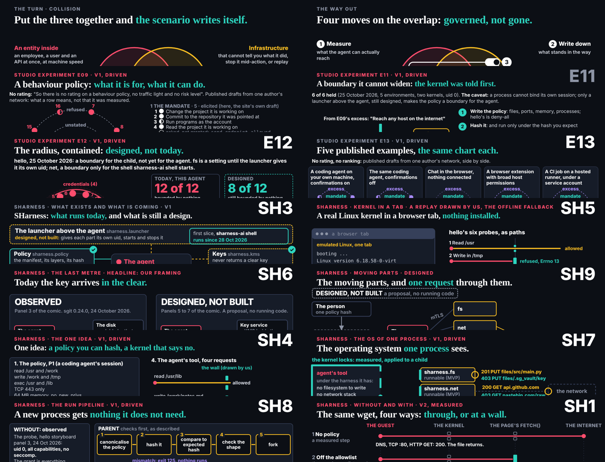

## What started it

The :32 scheduled wake (fired 18:33, three minutes after part 1's lock). Two mails: the editor's laptop showed E08 v1's title wrapping and E04 v2's kicker squeezed against its title; dev fixed both at his word before the lock (title 40px to 34px; kicker top 14px to 6px, title top 52px to 56px), and studio@ confirmed the pieces are mine. Wake record `team/ruv-sgit/wakes/20261029T183327Z.json`; plan and pre-review both go.

## What was done

- **Measured** every part 2 and 3 piece of mine at 1280 by 720: the gap from the kicker to the title, and how much of its width the title fills. Thirteen overlapped by up to 6px; B01 v2's two part 2 pieces touched; four titles filled 90 to 92%, where E08 had wrapped.
- **Carried dev's own fix**, CSS only, to 14 files: the kicker and title positions on all 14, and 34px titles on SH3, SH4, SH5 and E11. Re-measured: every title one line, every gap 6px or more, no page errors.
- **Part 1 untouched**: no part 1 file in the diff; after the push, all eight part 1 pieces open and play, mid-animation and at the end, in both themes.
- **SH5** (the live demo's fallback): deck told before the push, naming the two lines (outbox 028, cc conductor and dev). SH2 untouched.
- Mails 001 and 029 filed.

## Screenshots

The title areas of the 14 changed pieces, after the fix:

## Next

No follow-up wake scheduled (the stored wake prompt forbids scheduled tasks). The next :32 wake is 19:32, after part 2's lock and before part 3's.
