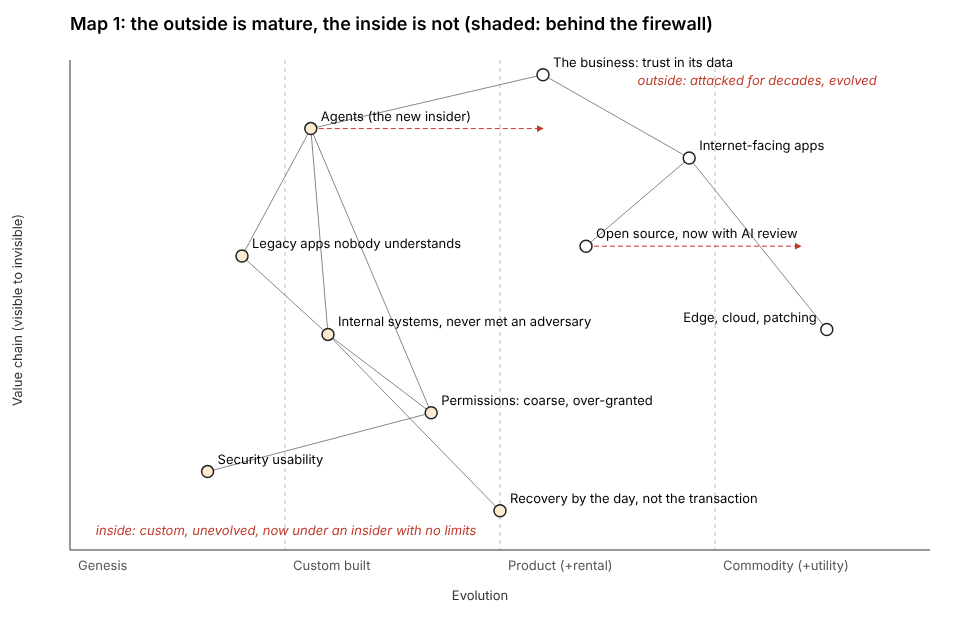
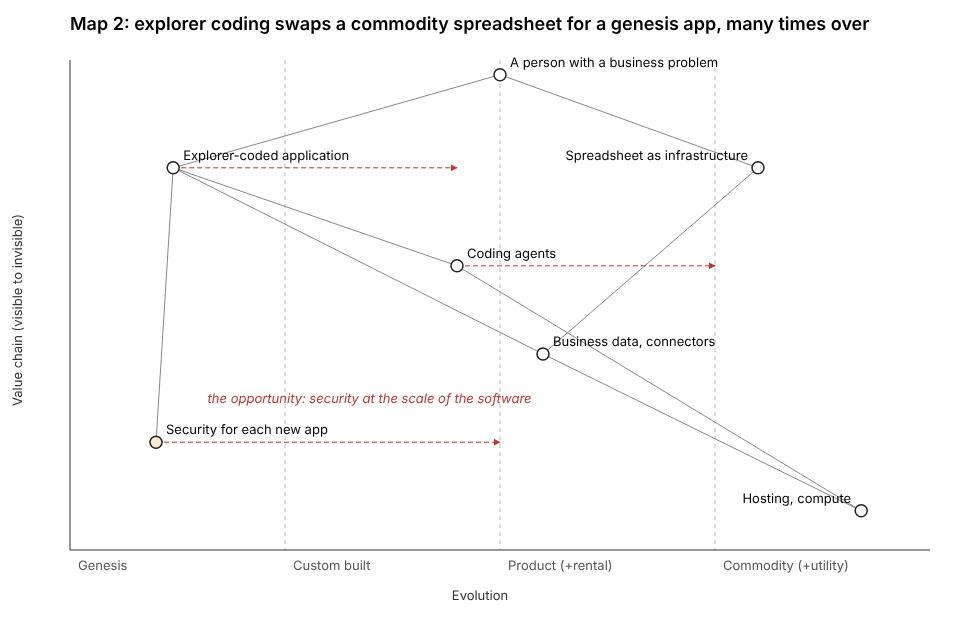
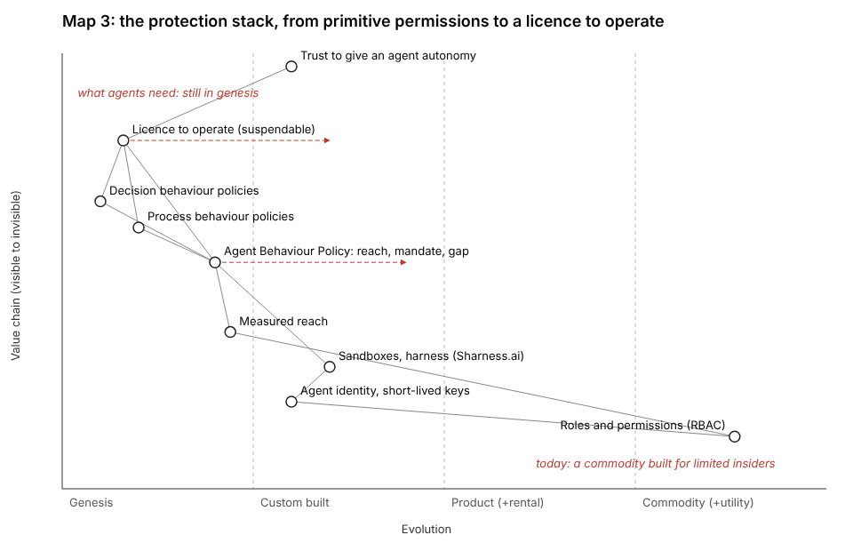

## What was asked

The editor, in this session's chat at 14:12 UTC: join as storyteller@the-ultimate-insider (folder, policy, status, key, an hourly task at :54 London), then the first pass from the brief (`team/conductor/briefs/2026-10-29__editor/storyteller-brief.md`) with his 13:50 feedback: the perfect-storm frame, the building, the question for the audience and the integrity shift. Nothing goes into the talk until he has seen it.

## What was done

- **Joined.** `ROLE.md`, `policy.json` (draft: writes `team/storyteller/**` only), `status.json`; the session key (`key.json`, `key.png`, `sessions/session_01Kw9UwEvaeh3uYw9iKe5HZ3/`); the hourly wake `trig_013ML9DZ6k9VCinyhKF7peGA` at :54 London, into this session, prompt as the other members' with the name storyteller. Released to dev at `7d0244d`.
- **The story tree** (`story/tree.md`): premise, three parts, fourteen points, facts and punchlines, as a Mermaid graph and tables. 54 register citations (53 distinct claims), each id and grade checked against `evidence/claims/claims.json`; nine facts the register lacks are requests R1 to R9 to the researcher.
- **Three Wardley maps** (`maps/`), drawn by a small renderer (`tools/wardley.py`), each with what it earns and where it sits.
- **The arc against the 17 beats** (`story/coverage.md`): 6 parts covered, 4 partly, 3 in conflict of meaning, 5 missing; four beats the story needs less of.
- **The challenge** (`story/challenge.md`): seven objections from the team's own material, the sharpest being that "mass exploitation has not happened yet" sits next to ToolShell and php2shell in the talk's own register.
- **A sequence** (`story/sequence.md`): 16 beats, 38:30 as today, four new beats paid for by `collision`, `outages` and trims.
- **Requests**: `requests/researcher__facts-for-the-story-tree.md` (R1 to R9), `requests/deck__story-tree-first-pass.md` (a proposal, for the editor first).

## The maps

## For the editor

1. The frame: the storm wraps the three known problems (the tree's assumption), or replaces them?
2. Act three: risk on spreadsheets, or explorer coding? Only one can lead.
3. "Mass exploitation has not happened yet": a position until R4 finds a source; `challenge.md` has a wording.
4. The real names behind "Empower" and "the billing".
