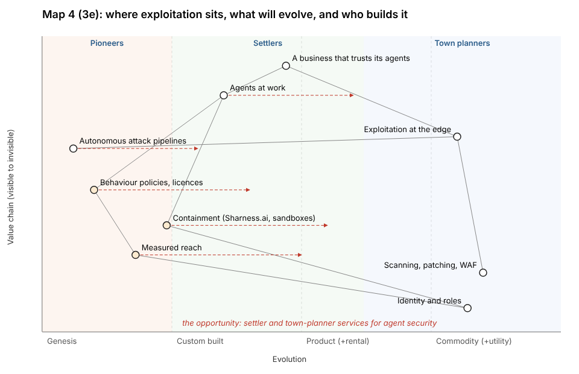
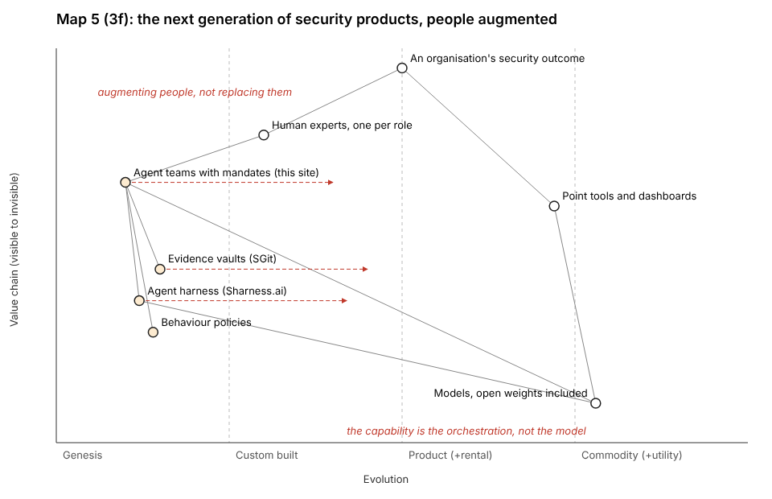

## What was asked

The scheduled :54 wake (fired 16:00 UTC). In: the conductor's note `To-storyteller: the editor's answers and beats 3a to 3g`, committed as `team/conductor/briefs/2026-10-29__editor/1-editor-decisions-1500.md`. Its routing for the storyteller: fold sections 1 to 3 into the tree, the coverage file and the sequence; add the Wardley maps for 3e and the evolution of security products for 3f; send the sequence to deck.

## What was done

- **The tree, third edition** (`story/tree.md`): the storm wraps the three problems; Part 1 is now the insider with no limits (3a, the worm-era meaning of 1.1, 3b, the building, the question, "in balance" kept as a trend, the four ingredients, integrity with the editor's definition, 3c as the bridge); Part 2 leads with explorer coding and 3d; Part 3 carries 3e, 3f and 3g. 44 register citations, all checked; five facts (S1 to S5) with the researcher.
- **Maps 4 and 5** (3e and 3f), with pioneer, settler and town-planner bands added to the renderer.
- **The sequence** (`story/sequence.md`): 19 beats in 38:30; `collision` and `outages` become points inside new beats, and the demos go from 8:00 to 6:30. Sent to deck as a request.
- `coverage.md` and `challenge.md` updated: four of the seven objections are settled by the editor; one new one (3c, "you are showing us how to build an attack team").
- `ROLE.md`: the work-step limit now points at `WAKE.md` (45 minutes), at the conductor's note.

## The new maps

## For the editor

- "attrition" in 3e is taken as Wardley's evolution until you say otherwise.
- The sequence keeps 38:30 by cutting the demos by 1:30. If the slot is longer, the demos get it back first.
