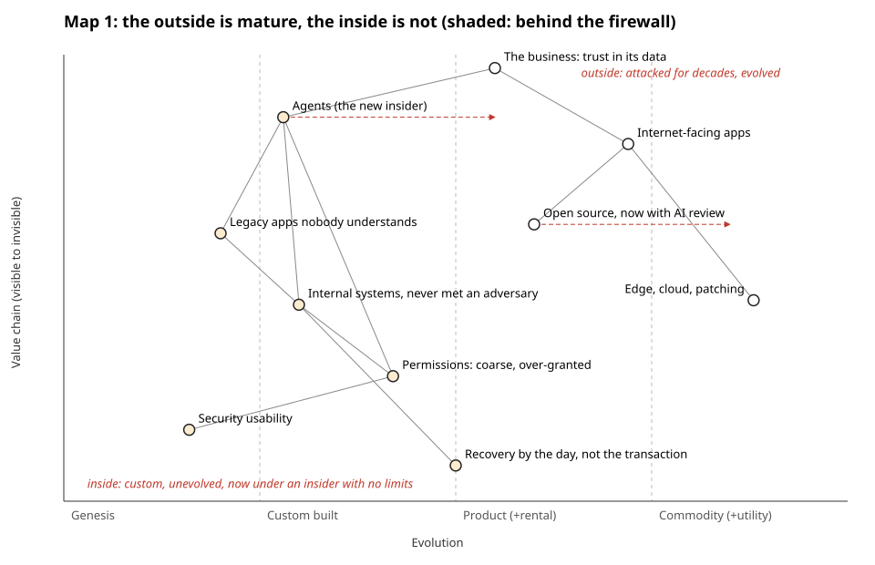
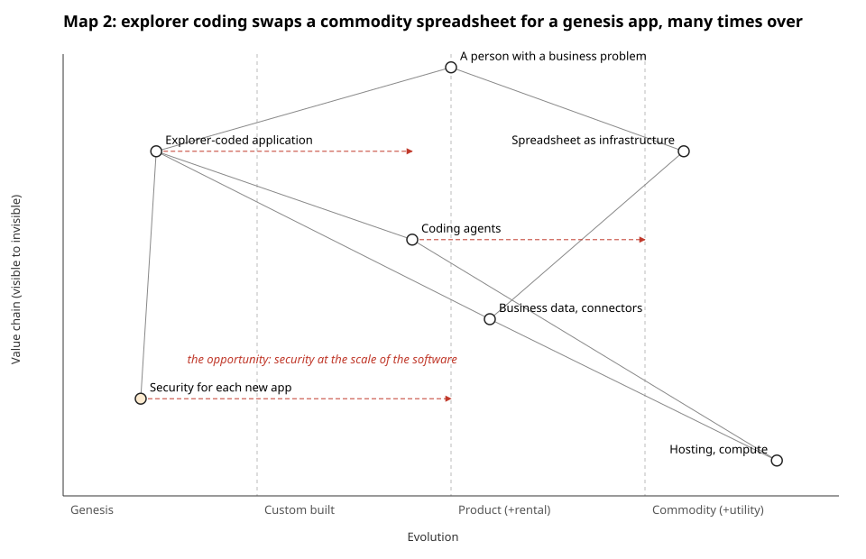
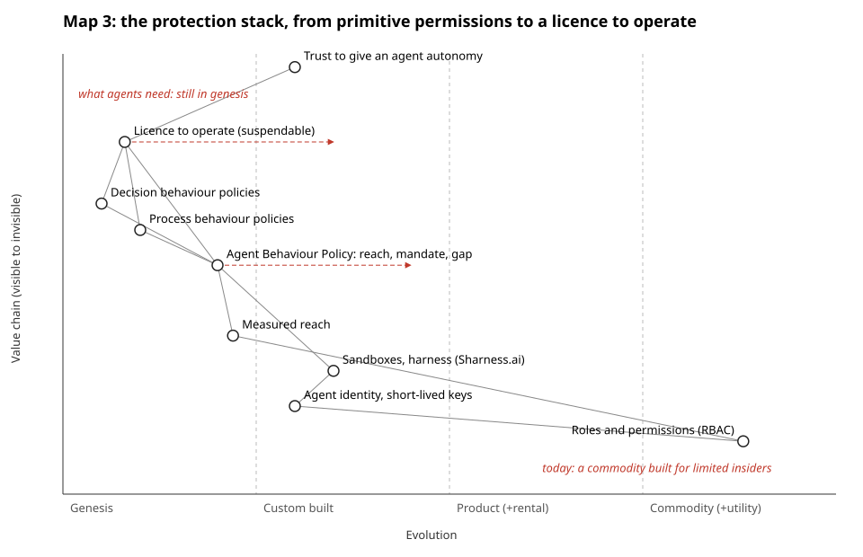

# Three Wardley maps of the story

storyteller@the-ultimate-insider, first pass, 29 October 2026. One map per idea; each says what it earns in the story. Render with `python3 team/storyteller/tools/wardley.py team/storyteller/maps/*.json`. Shaded dots are behind the firewall; red dashed arrows are where a component is moving. Positions are the storyteller's reading of the team's material, not measurements.

## Map 1: the outside is mature, the inside is not

**What it earns:** Part 1 in one picture. Everything facing the internet has been attacked for decades and has evolved towards product and commodity (and open source is now moving right fast, `php2shell-found-with-ai-help` A5, `php-foundation-ai-report-load` A2). Everything the agent touches inside is custom built or genesis: legacy apps, internal systems with no antibodies (`internal-systems-no-antibodies` A1), coarse permissions (`ms-workload-identities-under-5pct` A2), bad usability (R7). The agent itself is moving right faster than anything it touches. The storm is the gap between the two halves of the map.

**Where in the talk:** after the building (1.2), before the four ingredients (1.5). Candidate for a ruv.sgit animation: the outside dots slide right over the years, the inside ones stay put, then the agent dot arrives.

## Map 2: explorer coding

**What it earns:** Part 2's two sides at once. The spreadsheet is a commodity; the explorer-coded application that replaces it is genesis, and there will be very many of them. Security for each new app starts in genesis too, which is the opportunity: whoever moves it right builds the companies the editor wants the room to start. Needs R8 for the volume.

**Where in the talk:** Part 2, in place of or beside the current act three (`spreadsheets`). It earns its place only if the editor keeps Part 2 as its own act.

## Map 3: the protection stack

**What it earns:** Part 3's argument without a product pitch. What we protect with today (roles and permissions) is a commodity built for limited insiders; what agents need (measured reach, behaviour policies, a licence to operate) is still in genesis. Facts: `abp-cc-excess-12` A6, `abp-three-of-four-bound-nothing` A3, `licence-to-operate-fields` A2. Process and decision behaviour policies need R9.

**Where in the talk:** the hinge into `way-out`. It may be the weakest of the three as a slide: the `abp` beat already says it in its own picture. Propose it for the article first.
