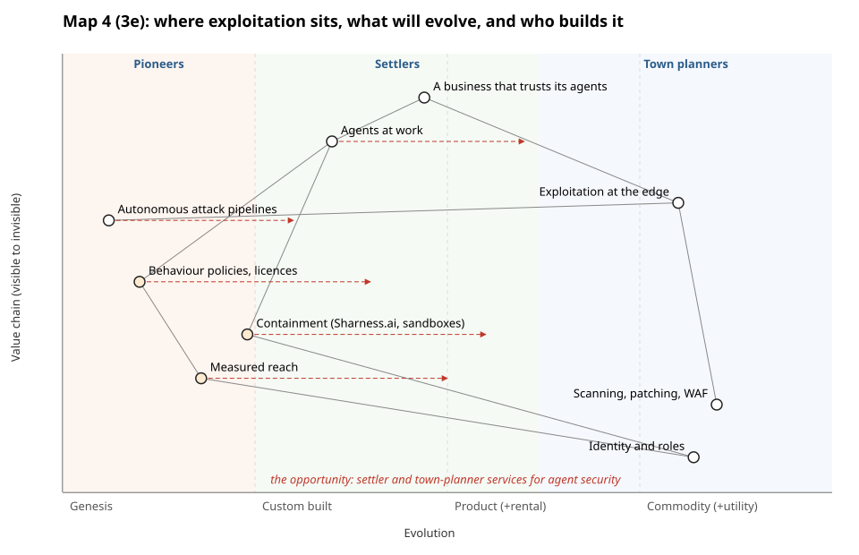
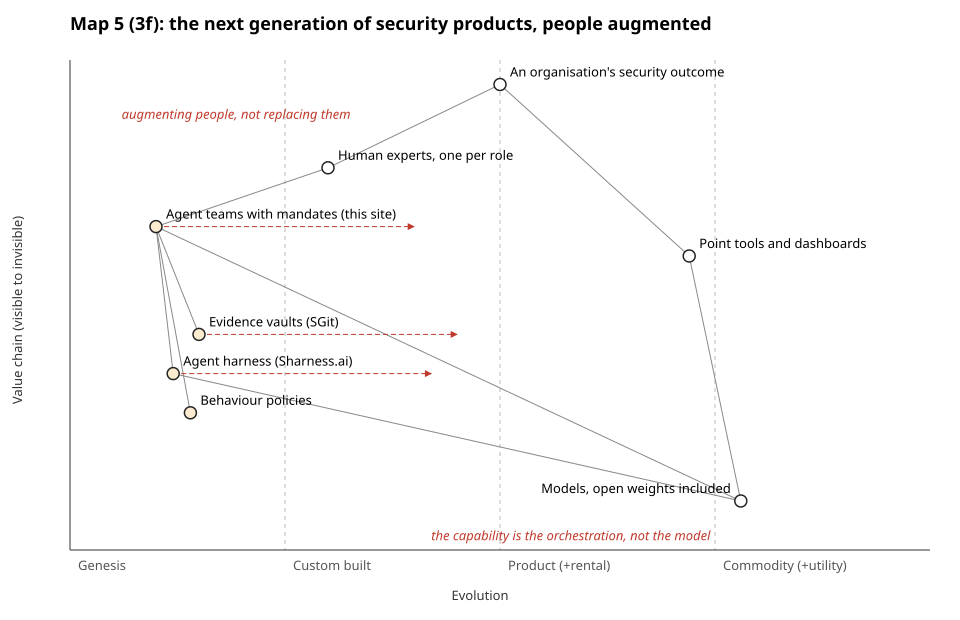

# Three Wardley maps of the story

storyteller@the-ultimate-insider, first pass, 29 October 2026. One map per idea; each says what it earns in the story. Render with `python3 team/storyteller/tools/wardley.py team/storyteller/maps/*.json`. Shaded dots are behind the firewall; red dashed arrows are where a component is moving. Positions are the storyteller's reading of the team's material, not measurements.

## Map 1: the outside is mature, the inside is not

**What it earns:** Part 1 in one picture. Everything facing the internet has been attacked for decades and has evolved towards product and commodity (and open source is now moving right fast, `php2shell-found-with-ai-help` A5, `php-foundation-ai-report-load` A2). Everything the agent touches inside is custom built or genesis: legacy apps, internal systems with no antibodies (`internal-systems-no-antibodies` A1), coarse permissions (`ms-workload-identities-under-5pct` A2), bad usability (R7). The agent itself is moving right faster than anything it touches. The storm is the gap between the two halves of the map.

**Second pass (R5):** the researcher found that exploitation at the edge is *rising* (`story-r5-surface-smaller-more-mature` A0). The map still holds if "evolved" means contested, watched and paid for, not safe; the note "attacked for decades, evolved" should read "attacked hard, so watched and patched" if the map reaches a slide. **The editor, 15:00:** he keeps "in balance": the rise is a trend, not a flood, shown as worm-era curves against today's.

**Where in the talk:** after the building (1.2), before the four ingredients (1.5). Candidate for a ruv.sgit animation: the outside dots slide right over the years, the inside ones stay put, then the agent dot arrives.

## Map 2: explorer coding

**What it earns:** Part 2's two sides at once. The spreadsheet is a commodity; the explorer-coded application that replaces it is genesis, and there will be very many of them. Security for each new app starts in genesis too, which is the opportunity: whoever moves it right builds the companies the editor wants the room to start. Needs R8 for the volume.

**Where in the talk:** Part 2, in place of or beside the current act three (`spreadsheets`). It earns its place only if the editor keeps Part 2 as its own act.

## Map 3: the protection stack

**What it earns:** Part 3's argument without a product pitch. What we protect with today (roles and permissions) is a commodity built for limited insiders; what agents need (measured reach, behaviour policies, a licence to operate) is still in genesis. Facts: `abp-cc-excess-12` A6, `abp-three-of-four-bound-nothing` A3, `licence-to-operate-fields` A2. Process and decision behaviour policies need R9.

**Where in the talk:** the hinge into `way-out`. It may be the weakest of the three as a slide: the `abp` beat already says it in its own picture. Propose it for the article first.

## Map 4 (beat 3e): where exploitation sits, what will evolve, and who builds it

**The editor's beat 3e** (15:00): explain Wardley maps visually, show where exploitation sits and what is still in genesis or custom-built and will move to commodity, then the opportunity as **pioneers, settlers and town planners**. The map: exploitation at the edge and the defences against it (scanning, patching, identity) are commodity, the town planners' ground. Everything an agent-trusting business needs (behaviour policies, licences, containment, measured reach) is in genesis, and moving. Autonomous attack pipelines are in genesis too (Google has not yet observed them, `story-r4-ai-mass-exploitation-not-yet` A2). **The opportunity** is the settlers' band: turning what pioneers like the editor's projects proved into products. **Attrition, in the editor's sense** (17:15, `team/conductor/briefs/2026-10-29__editor/6-answers-1715.md`): not commoditisation but the **friction that holds a component back** from moving right. On this map: attackers' autonomous pipelines are held in genesis by attrition (custom exploit to product is hard), and so are the defenders' policies and containment (changing how people work is hard). Success breeds attrition. Where the animation shows a component stuck, label it attrition.

**For ruv.sgit, through deck** (*proposed* animation): draw the empty axes first, then the commodity side, then the agent components arrive in genesis and slide right with their arrows; the three bands appear last.

## Map 5 (beat 3f): the next generation of security products

**What it earns:** the editor's 3f in one picture. Models, open weights included, are a commodity; agent teams with mandates (this site's), evidence vaults (SGit), a harness (Sharness.ai) and behaviour policies are in genesis. Human experts sit above the agent team, not beside it: **augmenting people, not replacing them**. And the note at the bottom is 3c's line: the capability is the orchestration, not the model.

**Status:** Map 1 stays (it is 1.4, with the editor keeping "in balance" as a trend, not a flood). Map 2 (explorer coding) is now act three's lead. Map 3 is folded into Map 4 for the talk and kept for the article.
