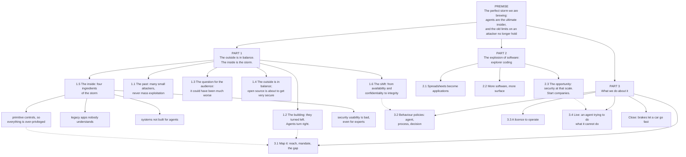

# The story tree: the perfect storm we are brewing

storyteller@the-ultimate-insider, first pass, 29 October 2026, for the editor. **Nothing here is in the talk.** It is the editor's memo and his 13:50 feedback, laid out as one tree and checked against the team's own material, so he can read the whole arc at a glance and decide.

How to read it:

- Every fact carries a claims-register id from `evidence/claims/claims.json`, with its grade (A0 unsupported to A6 established, `evidence/METHOD.md`), or a request id `R1` to `R9` (`team/storyteller/requests/researcher__facts-for-the-story-tree.md`).
- **Punchlines** are the editor's lines or proposals for his lines. The ones marked *proposed* are the storyteller's wording, for him to keep, change or drop.
- A position (A0 to A3 by the register's own rule) is shown as a position, not as a fact.

## The tree at a glance

## PREMISE: the perfect storm we are brewing

**The line.** Three things we already know about separately are now arriving together: agents that act as insiders with no insider's limits, an inside that was never built to hold them, and an explosion of software that multiplies both. None of them is new. Together they are a storm, and we are brewing it ourselves.

**Why "brewing" matters** (*proposed*): it says the storm is made by us, in our own buildings, by choices we are making now. That is a call to act, not a forecast of doom, and it replaces "nobody is presenting them as one story", which the editor found arrogant.

**The old limits on an attacker** (the editor's list): skill, motivation, time, creativity, perseverance.

| Fact | Source |
|---|---|
| An agent is a language model in a loop with tools, iterating until it decides it is done | `agent-anthropic-definition` A6 |
| It has skills no insider ever had: every language, schema, API | `agent-skills-no-insider-had` A0, a position |
| A threat is anything that causes business impact; malice is optional | `threat-definition-malice-optional` A1 |
| Average annual cost of insider risk, 17.4 million dollars | `insider-cost-17-4m` A2 |

**Punchline:** "An agent is an insider with no limits: it never gets tired, never gets bored, and never stops at the first door." (*proposed*)

## PART 1: The outside is in balance. The inside is the storm.

### 1.1 The past: many small attackers, never mass exploitation

The editor's claim: mass exploitation through AI has not happened yet, because of the attackers' business model, how hard exploitation is, and an asymmetry (an exploit's owner does not burn it on the shiny target). The ability is there; the missing ingredient is intent.

| Fact | Source |
|---|---|
| AI-found PHP flaws (php2shell) are on CISA's exploited list, yet no named victim | `php2shell-in-cisa-kev` A6, `php2shell-no-named-victim` A2 |
| Frontier AI found the flaw ahead of attackers | `php2shell-ahead-of-attackers` A2 |
| A state actor drove Claude Code through an espionage campaign, 80 to 90 per cent of the work; about 30 targets | `claude-code-espionage-80-90` A3 |
| ToolShell: at least 54 organisations before a patch existed, ransomware following | `toolshell-54-orgs-before-patch` A2, `toolshell-ransomware-following` A2 |
| Evidence that AI-driven mass exploitation has not (yet) been seen | **R4** |

**Punchline:** "The ability is here. What is missing is intent. And an agent does not need intent." (*proposed*: it links 1.1 to the premise, since three of the five incidents in the talk were not attacks, `three-of-five-not-attacks` A2.)

### 1.2 The building: they turned left. Agents turn right.

The editor's picture: an attacker gets into a huge building and turns left, where there are only small things, instead of right, where the gold is. Many small figures, each making a choice; most turn left, until the agents turn right. (ruv.sgit's animation, briefed by deck.)

| Fact | Source |
|---|---|
| Incidents where the attackers had far more access than they used | **R1** (the editor's ask to the researcher, 13:50) |
| The grant is everything the role ever accumulated; workload identities use under 5 per cent of what they are granted | `grant-is-everything-accumulated` A2, `ms-workload-identities-under-5pct` A2 |
| 82 machine identities per human, 42 per cent privileged | `cyberark-82-to-1` A3, `cyberark-42-percent-privileged` A3 |
| A coding agent hit a credential mismatch, found a broad token in an unrelated file and used it (it turned right) | `e04-pocketos-cursor-railway` A4 |

**Punchline:** "Humans turn left because they get tired, scared or bored. Agents turn right because right is where the answer is." (*proposed*)

### 1.3 The question for the audience: it could have been much worse

The editor's question, put to the room: *in every incident you have seen, the attackers could have done much more damage, even where the damage was large. Why didn't they?*

| Fact | Source |
|---|---|
| Amazon Q shipped with a wiper prompt and failed only because of a formatting flaw; live two days | `amazon-q-injected-wiper-prompt` A5, `amazon-q-two-days-live` A1 |
| Replit: 1,200 executives' records gone, by an agent doing what it judged valid | `replit-1200-executives-gone` A3 |
| Counter-factuals on real incidents: what more the access allowed | **R1** |

**Punchline:** "Every incident you know was the attacker's restraint, not your control." (*proposed*. It is strong and it is a position: the register would hold it at A3 at most.)

### 1.4 The outside is in balance; open source is about to get very secure

| Fact | Source |
|---|---|
| Every attack on an exposed asset improves its security; the outside surface is smaller and more mature | position, the editor's; **R5** for support |
| PHP: 15 CVEs since 1 July, 100+ invalid AI-era reports worked through | `php-foundation-ai-report-load` A2 |
| php2shell found with AI help, reporters include OpenAI and Wiz | `php2shell-found-with-ai-help` A5, `php2shell-reporters-openai-codex-security` A5 |
| The counterweight: much more software to protect | see Part 2, **R8** |

**Punchline:** "Open source finally has the eyeballs it never had. The inside never had any." (*proposed*; it hands over to `internal-systems-no-antibodies` A1, "the systems behind the firewall have never met an adversary".)

### 1.5 The inside: four ingredients of the storm

| Ingredient | Facts | Source |
|---|---|---|
| **Legacy apps nobody understands**, mission-critical, "if it works, leave it" | scale of legacy code in critical work | **R6** |
| **Systems not built for agents** | recovery is by the day, not the transaction; containment never designed for agent rates; Replit's basics added afterwards | `recovery-edits-not-appends-daily-backups` A1, `containment-not-designed` A1, `replit-four-fixes` A3 |
| **Primitive controls, so everything is over-privileged** | super admins use under 2 per cent, 40 per cent are workloads; 88 per cent define a privileged user as a human; three of four barrier kinds bound nothing | `ms-super-admins-under-2pct-40pct-workloads` A2, `cyberark-88-percent-human-definition` A2, `abp-three-of-four-bound-nothing` A3 |
| **Security usability is bad, even for experts** | examples from ux.sgit.ai | **R7** |

**Punchline:** "We got away with over-privilege because the insider was limited. The new insider is not." (the editor's memo, nearly word for word)

### 1.6 The shift: from availability and confidentiality to integrity

The editor's point: past attacks were mostly against availability or confidentiality. Agents bring attacks on integrity, which are far more dangerous: a small amount of corrupted data is enough to lose trust in the whole system, and agents do that damage fast and everywhere.

| Fact | Source |
|---|---|
| Share of past attacks by availability, confidentiality, integrity | **R2** |
| Small corruption, whole-system loss of trust; agent cases first | **R3** |
| Agent incidents in the register that are integrity events (data changed or destroyed, not stolen): Replit, Gemini CLI, Kiro, the Meta inbox | `replit-deletes-prod-db` A5, `gemini-cli-failed-you` A3, `e04-aws-kiro-cost-explorer` A2, `e04-openclaw-meta-inbox` A2 |
| Recovery runs by the day, not by the transaction, so a corrupted row is found late | `recovery-edits-not-appends-daily-backups` A1 |

**Punchline:** "A thief takes a copy. An agent changes the original. After that, you cannot trust any of it." (*proposed*)

## PART 2: The explosion of software: explorer coding

### 2.1 Spreadsheets become applications

The editor's term, used as he says it: **explorer coding**, people exploring by building software that was never built before. Better than a spreadsheet as infrastructure.

| Fact | Source |
|---|---|
| Volume of new apps by non-developers | **R8** |
| 48 per cent track risk in spreadsheets; 86 per cent of smaller companies use them in some part of GRC | `spreadsheets-48pct` A1, `smb-86pct-spreadsheets` A2 |

### 2.2 More software, more surface

| Fact | Source |
|---|---|
| This site: 391 pages in ten hours, and its own desk found 11 of 70 claims overreaching (the editor's own explorer coding) | `php-site-first-day-11-of-70` A2 |
| 2 people and 19 agents | `php-team-size` A1 |

### 2.3 The opportunity: security at that scale. Start companies.

**Punchline:** "For the first time we can do security at the scale of the software. That is not a problem statement. It is a market." (*proposed*)

## PART 3: What we do about it

| Point | Facts | Source |
|---|---|---|
| 3.1 Map it: reach, mandate, the gap, what stands in it | Claude Code CLI: grant 16, mandate 5, excess 12; one barrier moved and not one number did | `abp-cc-grant-16` A6, `abp-cc-mandate-5` A6, `abp-cc-excess-12` A6, `abp-cc-one-barrier-moved` A6 |
| | Most controls are expectations | `most-controls-are-expectations` A2, `abp-four-barrier-kinds` A3 |
| 3.2 Behaviour policies: agent, process, decision | agent policies exist (ABP); process and decision policies are not yet in the register | `abp-reach-mandate-gap-barriers` A2; **R9** |
| 3.3 A licence to operate, suspended by the system | | `licence-to-operate-fields` A2, `licence-suspended-by-system` A1, `autonomy-earned-ladder` A1 |
| 3.4 Live: an agent trying to do what it cannot do (Linux in the browser, Sharness.ai) | six of six probes held, 24 to 29 October, five environments | `e11-six-of-six` A2, `e11-date-range` A2, `e11-five-environments` A2 |
| The editor's work threaded through: SGit, the open source projects, the newsroom, Sharness.ai, ux.sgit.ai | | `sgit-server-cannot-see` A2, `php-evidence-vault` A2 |

**Close.** "Brakes are what let a car go fast" (`brakes-irony` A1). *Proposed* tie-back to the premise: "We are brewing the storm. We can also build the brakes."

## Open questions for the editor

1. **The frame.** The perfect storm (inside against outside) replaces three collisions as the spine, or wraps it? The tree assumes it wraps: the three known things become the storm's ingredients.
2. **Act three.** The current act three is risk management on spreadsheets; the memo's part two is users' spreadsheets turning into applications. The tree keeps both in Part 2 (2.1), but only one can lead.
3. **"Mass exploitation has not happened yet"** sits next to ToolShell (54 organisations, ransomware) and php2shell on CISA's exploited list. The challenge file (`team/storyteller/story/challenge.md`) names how to say it so the room does not trip on it.
4. "Empower" and "the billing" in the list of projects: their real names.
