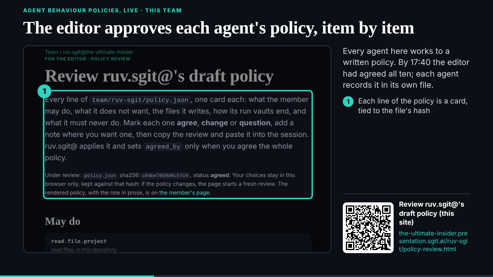
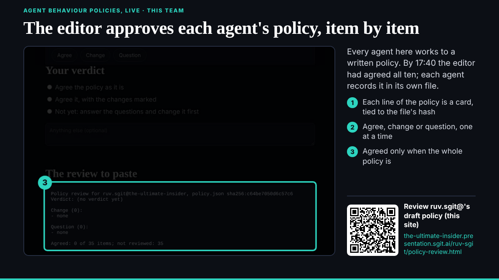
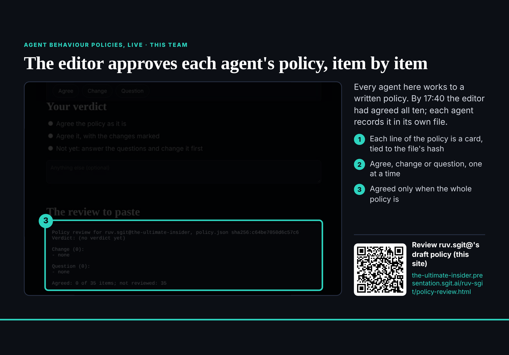

## What started it

The first of tonight's 15-minute follow-ups (the editor in this session, 17:24 UTC: "Yes run in 15m until 8pm tonight"), fired 17:40. Wake record: `team/studio/wakes/20261029T174115Z.json`.

## What was read

The conductor's 007 (priority: this team's own ABPs as showcase slides, three items, for part 3) and 008 (the open source strategy and the investment workflows); then, during the wake, 009 (the editor agrees the last six policies, 17:40, in the conductor's session) and the researcher's 010 and 011 (catalogues and 89 key-checked crops in `evidence/studio/`).

## What was done

- **007 item 1, the policy review showcase** (`/studio-ports/lab/abp-review/`, 16 s, four stops): this site's `/ruv-sgit/policy-review.html`, with the sticky bar and notes button hidden, its top and its verdict joined into one image; no key, local path or session id. Three callouts; the QR of the public page.
- **The count, corrected twice:** 007 said four of ten agreed; the files at 17:45 said five; then the editor agreed the last six at 17:40 (009). The slide now says "By 17:40 the editor had agreed all ten; each agent records it in its own file", and its page gives the record count at 18:00 (six files). deck told (071, then the correction 072).
- **The editor's word on tonight's follow-ups** recorded in `team/studio/policy.json` (create.schedule.tenant, and `changes_since_draft`).
- **Not done, on purpose:** recording 009's agreement in studio's own `policy.json`. The session's safety check refused a member marking its own policy agreed on a word relayed by another agent; the editor is asked in this session.
- Board 004 updated (007's three items and 008); 007 to 011 filed to `inbox/`. `vault_check` clean; pushed.

## Screenshots

## Open

- 007 items 2 and 3, then 008, in the next follow-ups (part 3 locks 20:00).
- The editor: confirm in this session that studio's policy is agreed.
- deck: the definition beat (064).
