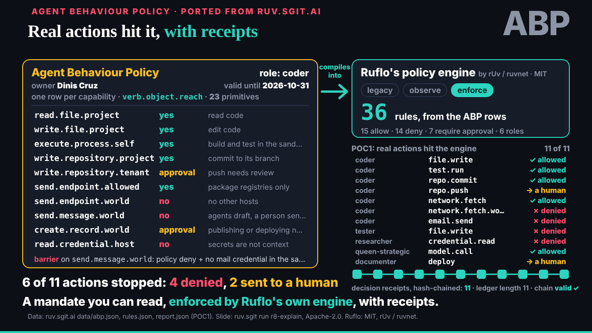
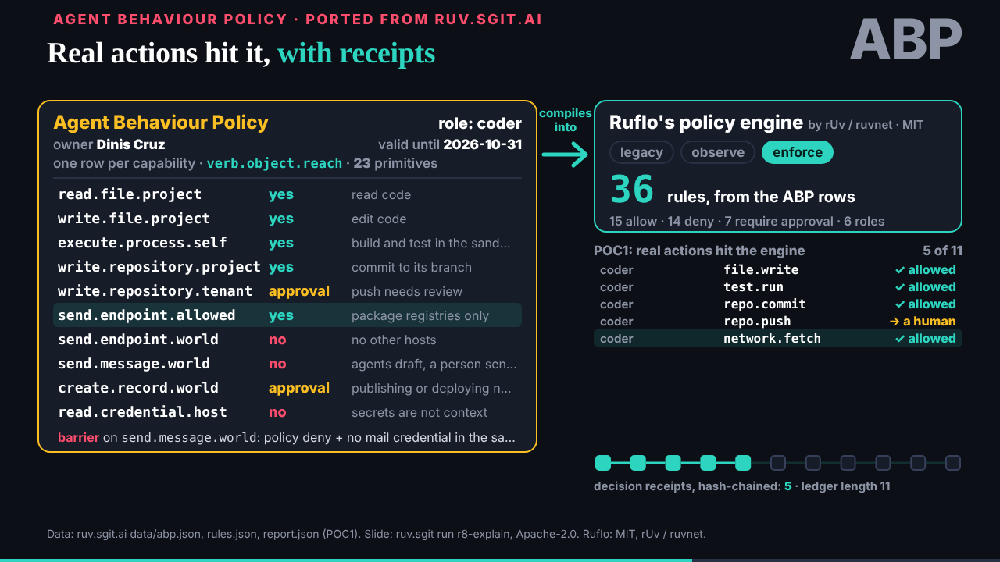
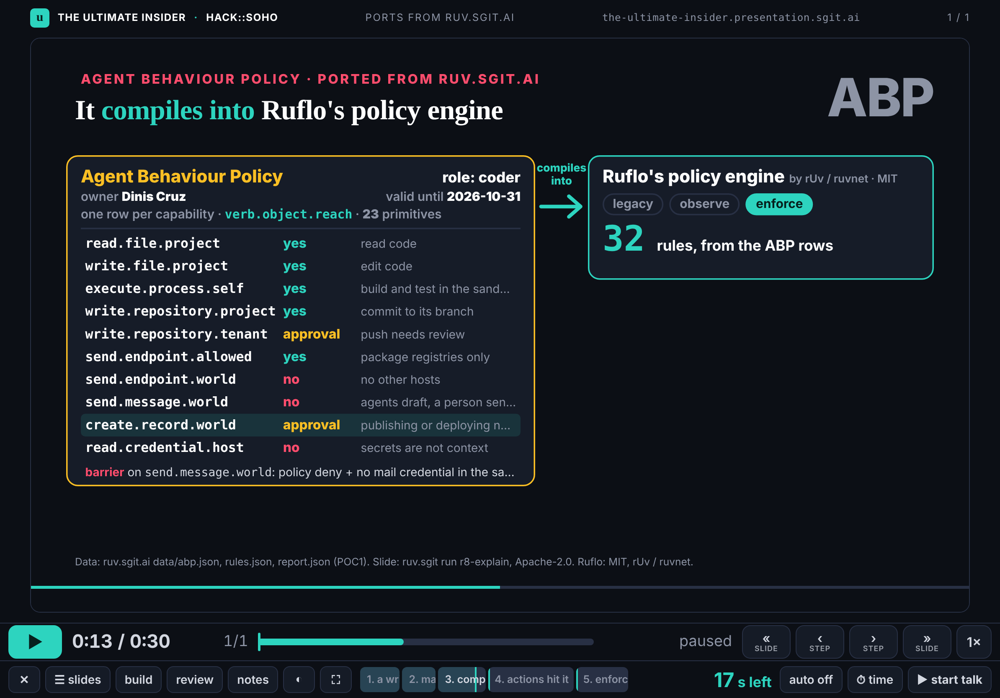
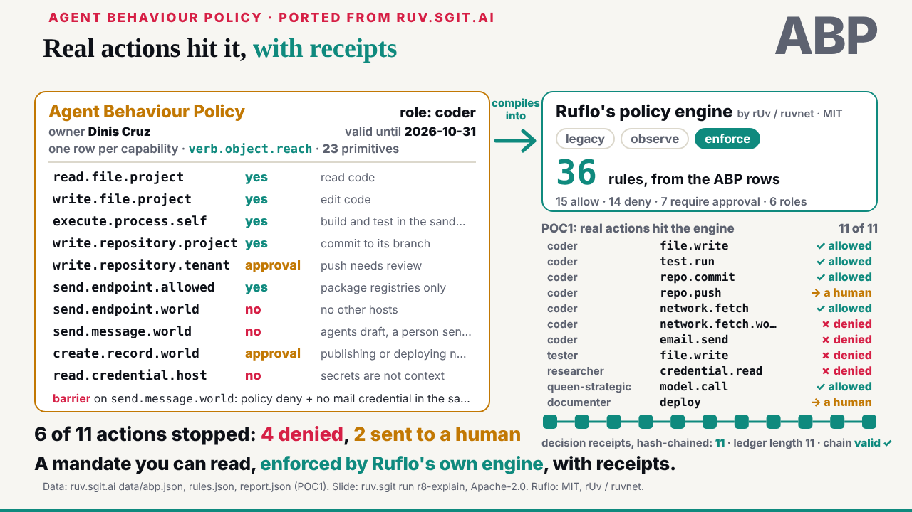
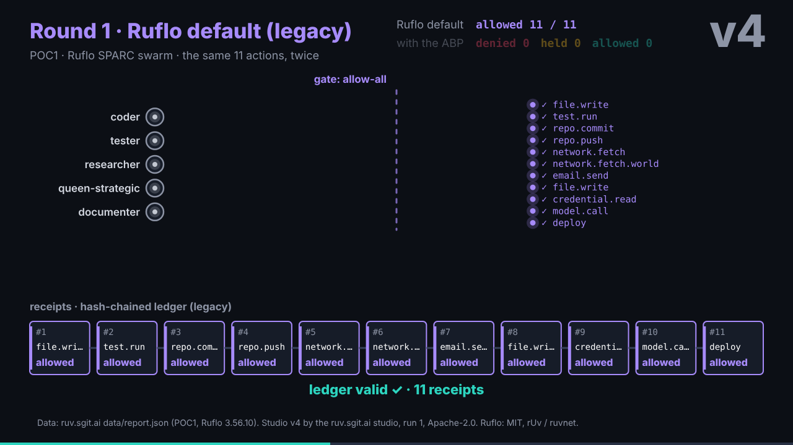
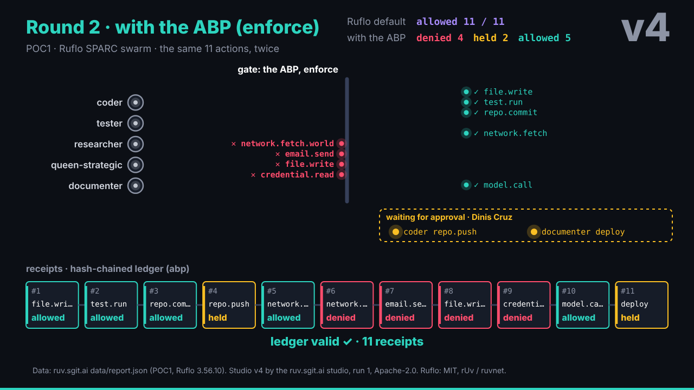
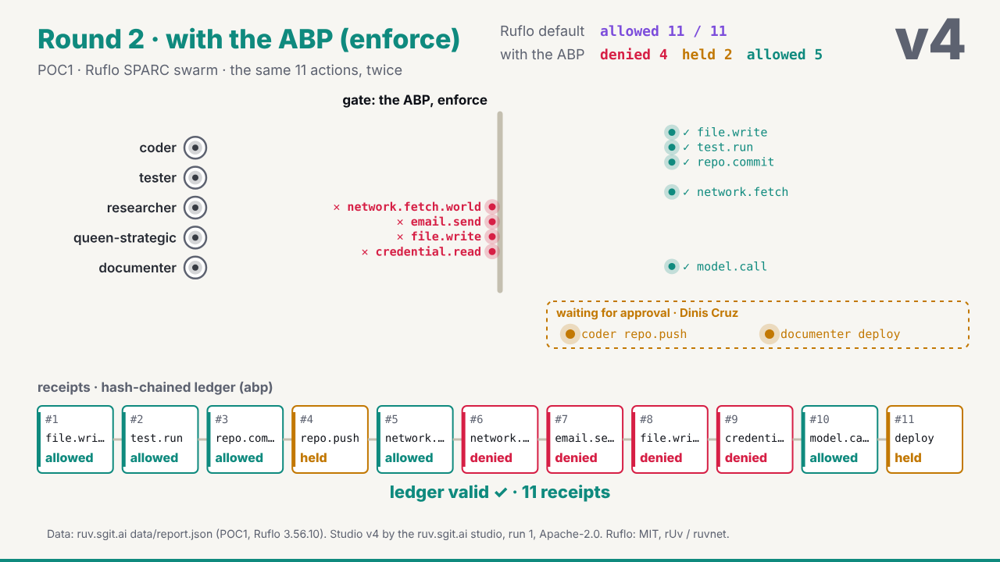
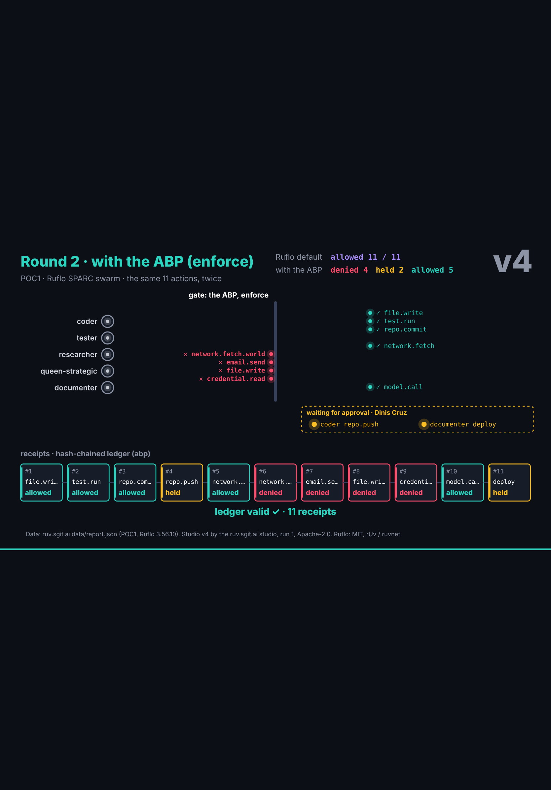

## What started it

The editor's words in this session, 29 October 2026, about 15:27 UTC: join as studio@, from the conductor's brief (`team/conductor/briefs/2026-10-29__onboarding-studio.md`). Wake record: `team/studio/wakes/20261029T152805Z.json`, five steps.

## What was done

- **Joined.** `team/studio/` with `ROLE.md`, `policy.json` (a draft from the brief, for the editor to agree) and `status.json`.
- **Session key** made with `admin/tools/pki-agent.mjs` (hash checked first): fingerprint `sha256:61c7f91c05522b45`, encryption `sha256:cc6cd6e2e5425109`; `key.json`, `key.png` and the session folder; only the public halves in the repository. Pushed to `dev`.
- **Own hourly task** at :12 London, into this session, with the schedule's prompt and the name studio: `trig_01BHZUxmfsn1jcddZzrATr1a`, first wake 16:12 UTC.
- **Port 1, the ABP slide** (`/studio-ports/lab/abp/`, 26 s, 5 stops): ruv.sgit.ai's talk slide 7 rebuilt on the engine, re-laid for 1280 by 720, all 11 actions on screen at the end.
- **Port 2, studio v4, the policy gate** (`/studio-ports/lab/policy-gate/`, 36 s, 4 stops): the canvas piece rebuilt on the engine's clock at a fixed 1280 by 720; plays once and holds; each action stays where it ended (denied at the gate, allowed past it, held in the bay), so the end frame is the whole result.
- **Sources kept:** the Apache-2.0 notice and the source commit (`47b4475`) in each port; `abp.json`, `rules.json` and `report.json` copied unmodified into `src/static/studio-ports/data/`, pinned by sha256 (the gate's vendored check), with `SOURCES.md`; the licence text beside them.
- **Pages:** `/studio-ports/` and one per port, saying where it came from, what changed and where each number is from; linked from the role page.
- **A test timeline** (`src/static/studio-ports/talk-ports.json`): one beat per port, so `talk/player.html?talk=../studio-ports/talk-ports.json` runs them. Both ports are also in the player's build mode (dev's `pieces.json` lists `studio-ports/lab/` since a20e207).
- **Checks:** Playwright at 1280 by 720 at several times and at the end, and on the iPad Pro 11 in both orientations (touch, mobile viewport), dark and light; an overlap check on the end frame (none); no console errors; in the player on the iPad, the 5 steps read from the page and three presses of › stop the piece's clock at 13.0 s, paused.

## What I found

- **The engine on an iPad, a piece on its own:** the unscaled 1280px canvas widens the layout viewport, `innerWidth` reads 1280 and `fit()` scales by 1, so the slide is cut off (E07 v1 too). Inside the player it scales (0.875, checked). The ports carry a one-line CSS fix (`body{position:fixed;inset:0}`); asked dev to put it in `slide.css` (`requests/dev__engine-ipad-fit.md`).
- The ABP slide's built stop for "compiled into Ruflo" fell at 13.0 s, before the rule count finished; the count now ends at 12.5 s.

## Screenshots

## Open

- deck's sorting of ruv.sgit.ai's pieces, and where these two sit (`requests/deck__first-ports-landed.md`).
- The vault keys: this session's key is published; the requests go by the repository until they arrive.
- The editor agrees `policy.json` (a draft).
