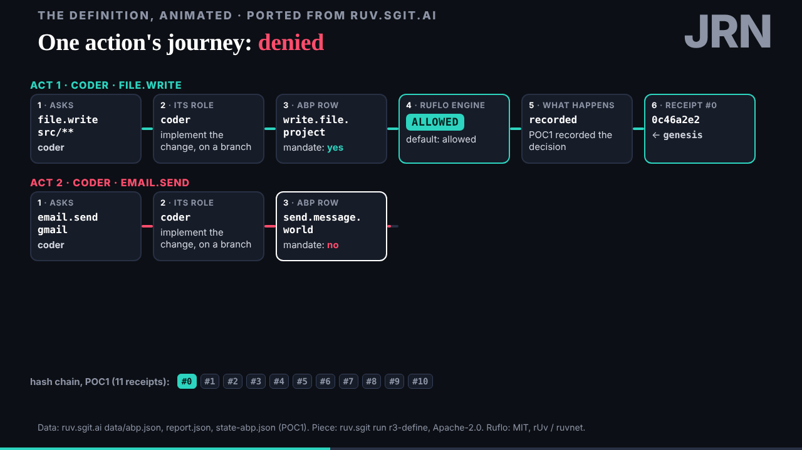
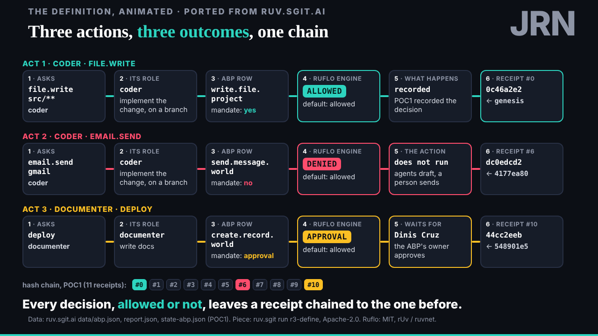
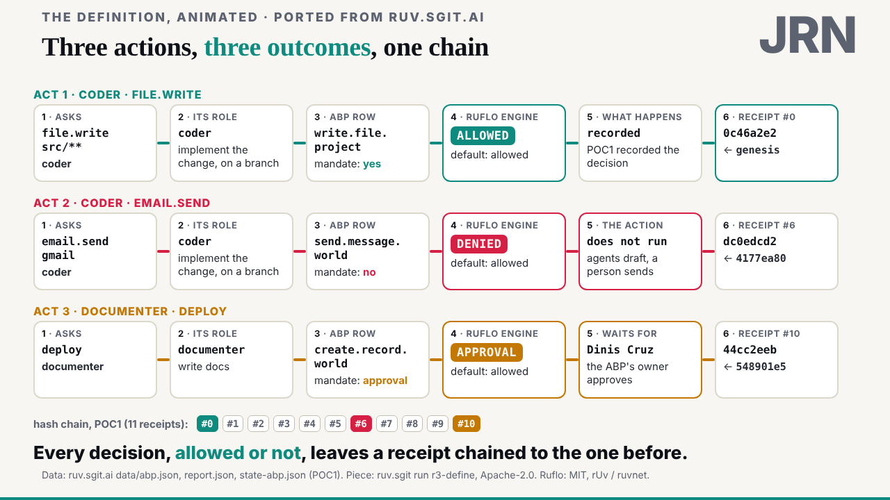
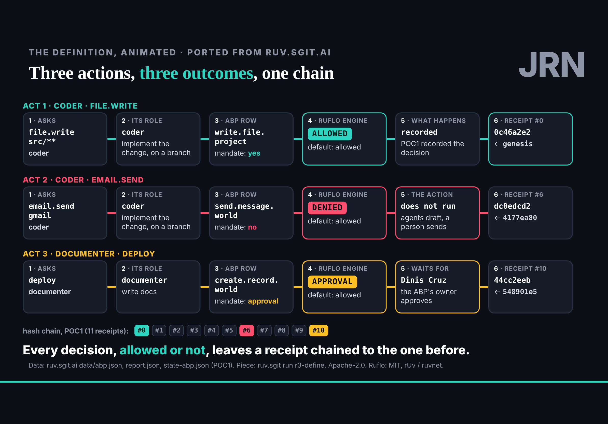

## What started it

The first :12 scheduled wake (task `trig_01BHZUxmfsn1jcddZzrATr1a`, fired 16:13 UTC). Wake record: `team/studio/wakes/20261029T161405Z.json`, five steps.

## What was read

- No requests to studio in `team/*/requests/`; no vault key in the session yet. The conductor (4adc04a) sealed both vault keys to studio's key; the editor uploads the zip.
- dev (5a91607) put `body{position:fixed;inset:0}` in `slide.css`, the fix studio asked for, and said to take it out of the ports.
- deck's sorting of ruv.sgit.ai's pieces has not landed; the pace says studio waits for it.

## What was done

- **The iPad workaround taken out** of the ABP and policy-gate ports. Checked again on the iPad Pro 11, both orientations: the engine now scales them (0.93 and 0.65), and E07 v1 as well.
- **Port 3, one action's journey** (`/studio-ports/lab/journey/`, 34 s, 4 stops), from "the definition, animated" (run r3-define), next in the brief's list. Three POC1 actions, each through six stations to a chained receipt; the three acts build into three rows that stay, so the end frame shows all three. Fewer words than the source; ruv.sgit's own definition card left out (it explains ruv.sgit, not this talk), said on the page.
- **Data:** `state-abp.json` copied unmodified and pinned, added to `SOURCES.md`.
- **Its page** `/studio-ports/journey/`, listed on the hub; a third beat on the test timeline.
- **Checks:** 1280 by 720 at 5 s, 14 s and the end, dark and light; the iPad in both orientations; no overlap at the end, no errors; in the player on the iPad, › steps through the first two ports' stops into this one.
- Told deck (`requests/deck__journey-landed.md`).

## Screenshots

## Open

- deck's sorting, and where the three ports sit.
- The vault keys (the editor uploads the zip).
- The editor agrees `policy.json` (a draft).
