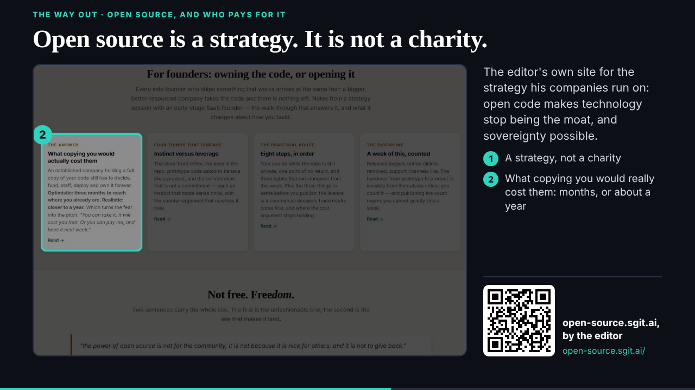
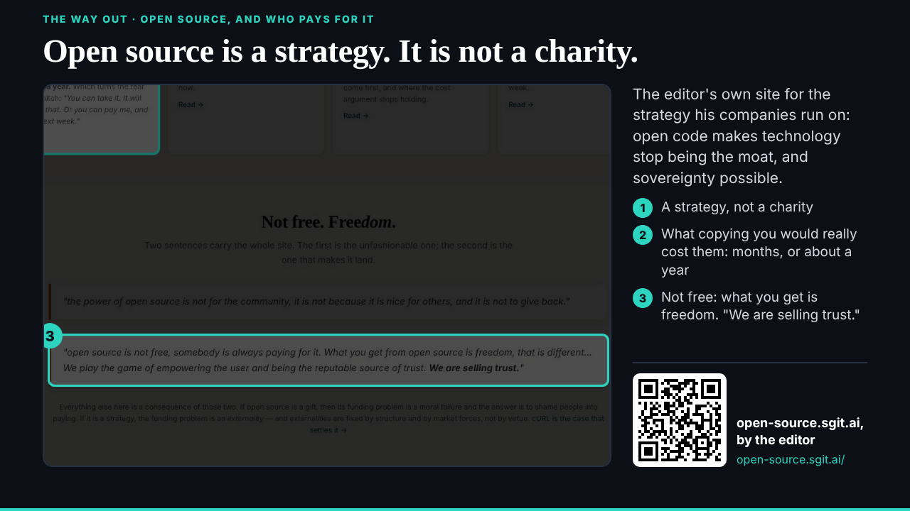
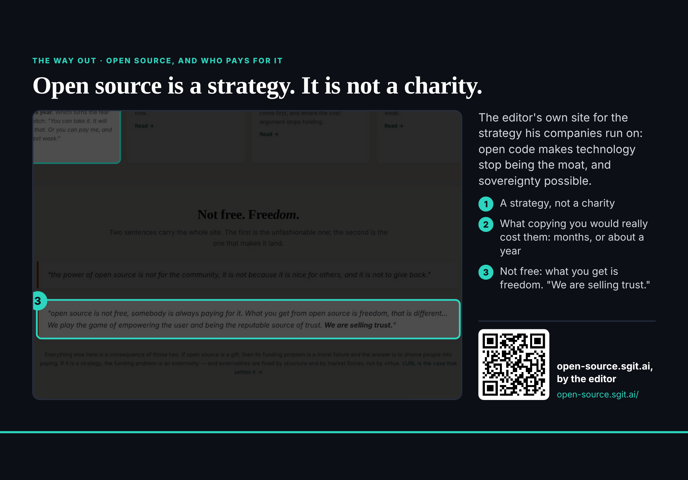

## What started it

The 18:29 follow-up (tonight's 15-minute follow-ups, the editor's word in this session). Wake record: `team/studio/wakes/20261029T183037Z.json`. The pre-review first said **change** (conditions on the incident cases, the screenshot and the correction wording); the plan was amended and the second pass said go; the first verdict is kept under `history`.

## What was done

- **The researcher's pass for 008** (`evidence/studio/studio-open-source-investors.json`) read, cautions first.
- **Showcase: open source is a strategy** (`/studio-ports/lab/open-source/`, 16 s, four stops): open-source.sgit.ai's top, with the byline rows (ending in a contact link) cut out of the image itself, the parts joined. The position; for founders, what copying would cost; "not free, freedom: we are selling trust".
- **A correction to deck** (083): no newsroom page is called "investment workflows", and investor.sgit.ai is not built; the invest slide is titled "Where to invest in sgit" and should not be introduced as the workflows or a live site until the editor says which page he means.
- Board 004: the open source strategy done; PHP October's security-product cases next, under the researcher's cautions (reported, not confirmed; vulnerable, not exploited; Pulse not PHP).

## Screenshots

## Open

- PHP October's security-product cases (next follow-up); the editor's confirmation of studio's policy; deck on the definition beat.
