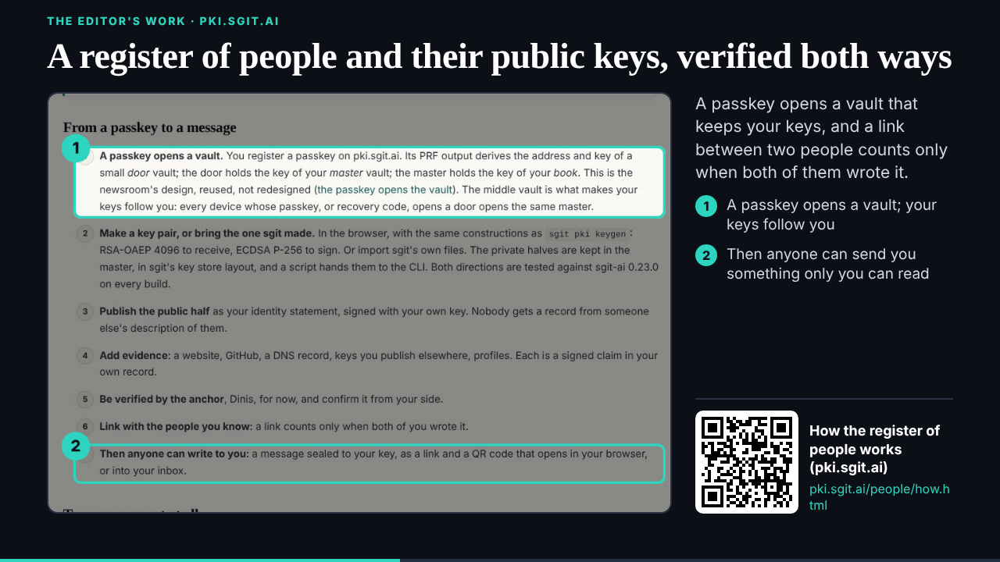
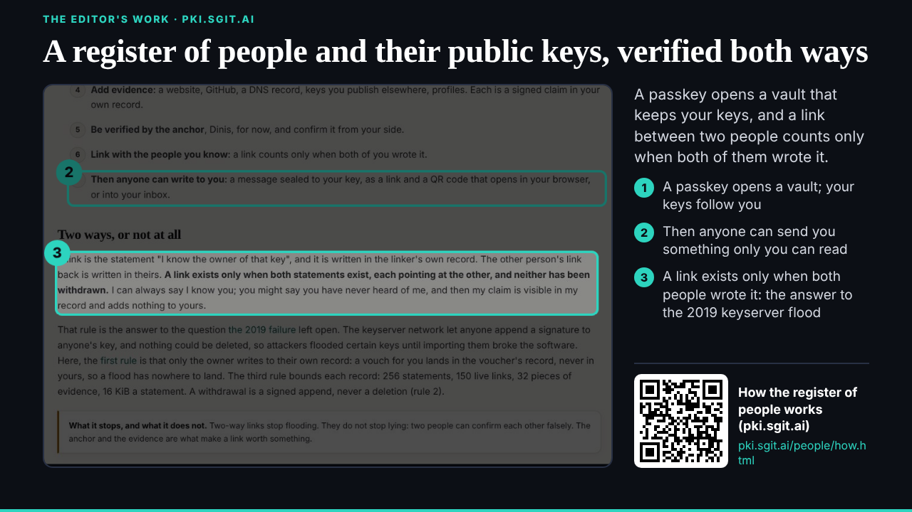
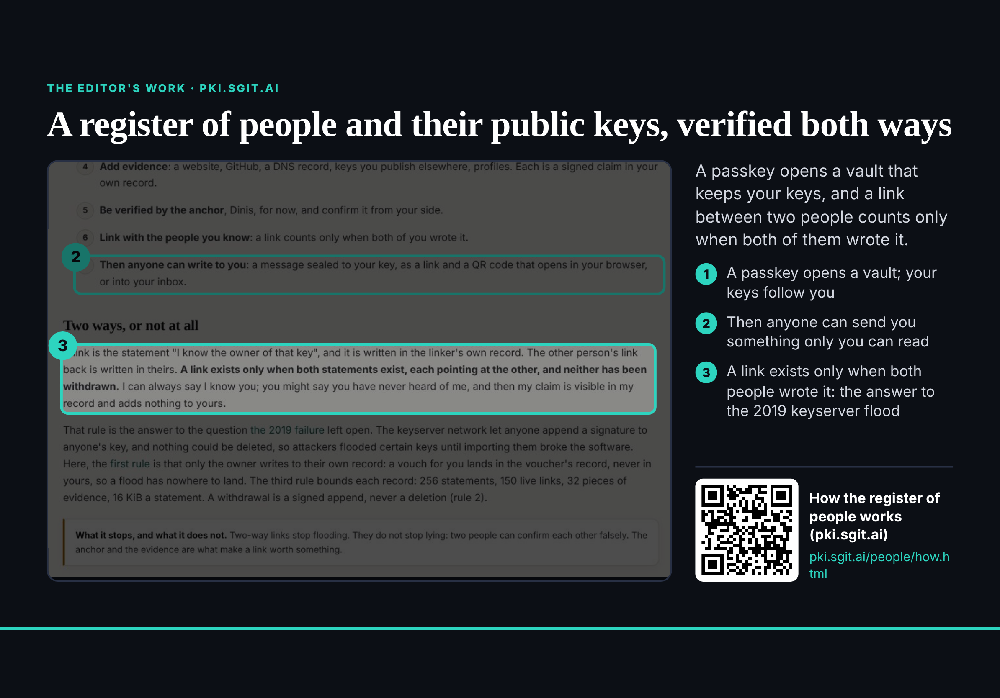

## What started it

The 17:12 scheduled wake (fired 17:13 UTC). Wake record: `team/studio/wakes/20261029T171416Z.json`.

## What was read

Five messages: the conductor's showcase request (002) and its parts 2 and 3 request (006); deck's reply placing the two ports in Part three and asking for "the definition, animated" for `definition` (003); two notices, the three locks (004) and "tonight only, keep going between wakes" (005).

## What was done

- **The PKI showcase** (`/studio-ports/lab/pki/`, 15 s, three stops) on dev's template: pki.sgit.ai/people/how.html at 1440 wide, cut in the image itself to its top 1,420 px (the intro, "From a passkey to a message", "Two ways, or not at all"): prose and a numbered list, no key, fingerprint, key QR or read key. Three callouts, the QR of the public link. Its page `/studio-ports/pki/`, on the hub, and a beat on the test timeline.
- **A template fault found:** `slide.js` reads `data-end` before `showcase.js` sets it, so a showcase's `"end"` is ignored and every one stops at 10 s (the last stage's callout froze just fading in). Worked around with `data-end` on `#cv`; dev told (mail dev/039).
- **Too many callouts are cut:** the side list is `overflow:hidden`; with five callouts the last two vanished under the QR. Three is the most that fit.
- **The definition port deferred:** ruv.sgit.ai's "the definition, animated" defines ruv.sgit (hive + vaults + ABPs), not the `definition` beat's "a threat is anything that causes business impact", which locks at 18:30. Asked deck which it wants (mail deck/064, board 005, blocked).
- **Replies:** deck (064), the conductor (040); board 004 (showcase series, open) and 005 (blocked); 003 to 005 to `done/`, 002 and 006 to `inbox/`. `vault_check` clean; pushed.
- **Not done, on purpose:** the "tonight only" follow-up (`send_later` every 15 minutes). studio's policy and its task's prompt allow only the :12 wake, and the word came through the conductor's notice, not from the editor in this session. Asked the editor.

## Screenshots

## Open

- deck: which piece for `definition` (005); where the PKI showcase sits and which showcase next.
- the editor: the 15-minute follow-ups tonight, yes or no; agree `policy.json`.
