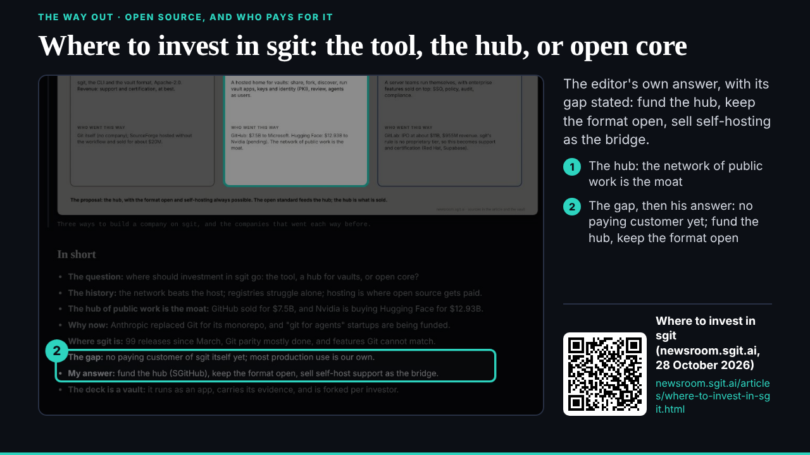
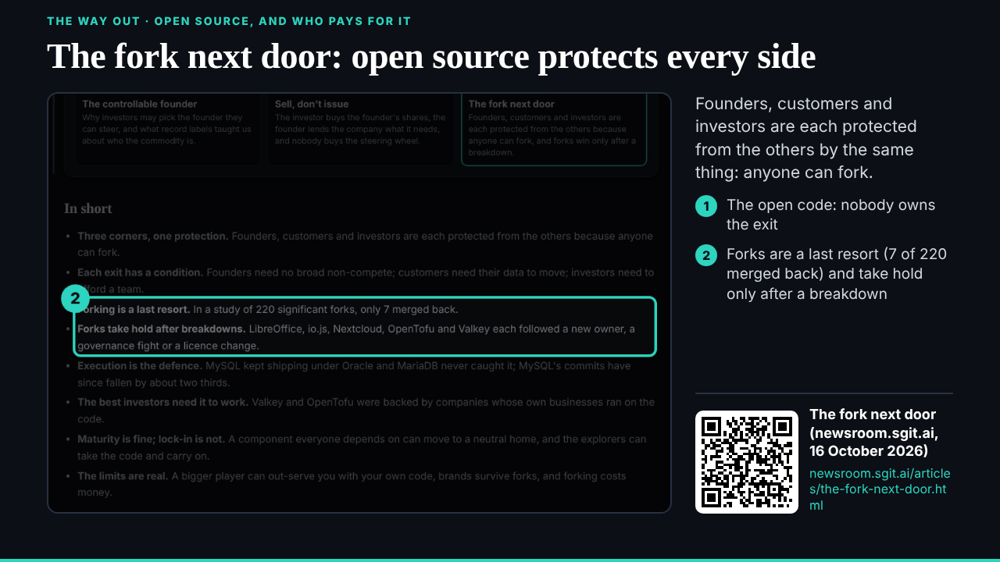
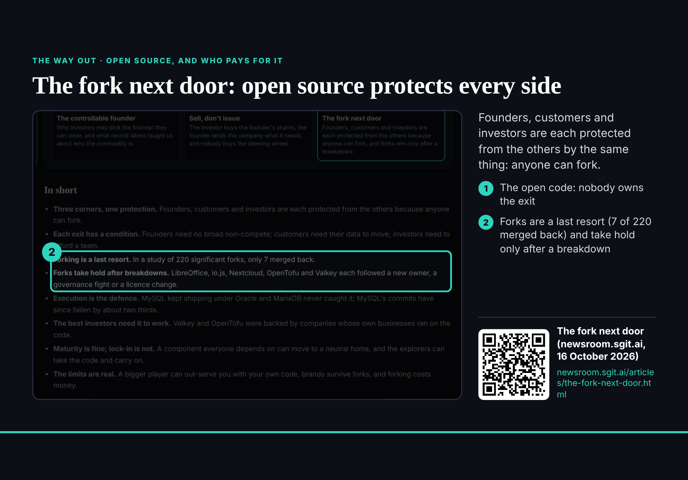

## What started it

The :12 hourly wake (fired 18:14 UTC). Wake record: `team/studio/wakes/20261029T181501Z.json`.

## What was done

- **The conductor's 008, two of four:** `/studio-ports/lab/invest/` ("Where to invest in sgit", 28 October: the tool, the hub or open core; his answer with its stated gap) and `/studio-ports/lab/fork/` ("The fork next door", 16 October: open source protects every side; 7 of 220 forks merged back). The researcher had no crops for them, so studio took the shots at 1440 wide and cut them to the top of each article, above any vault section; checked by eye: no key, read key, fingerprint or QR. Two adjacent callouts collided; merged into one each.
- Their pages, the hub, two test beats; deck told (079); board 004 updated. Still open from 008: the open source strategy as a whole, and PHP October's security-product cases, waiting for the researcher's links.
- **An out-of-scope request answered with the owner's name:** dev's urgent 013 (E08 v1's title wraps, part 1, before the 18:30 lock) asked studio to change `src/static/studio/lab/e08/v1/index.html`, which is ruv.sgit@'s. Not changed; replied to dev and ruv.sgit (copy the conductor) at 18:19 with the one-line fix (font-size 40px to 34px), and asked the editor in this session.

## Screenshots

## Open

- E08's title: its owner (ruv.sgit) or the editor's word.
- 008's last two; the editor's confirmation of studio's policy; deck on the definition beat.
